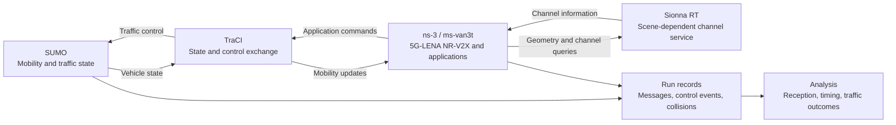

# Integrated 5G NR-V2X and Sionna RT Co-Simulation with ns-3 and SUMO

[](https://github.com/CAVISE-RnD/Sionna_SUMO_simu/actions/workflows/reproducibility.yml)
[](LICENSE)

An integrated research framework for connected vehicle communications and behavior analysis. The framework couples **ns-3 and 5G NR-V2X**, **Sionna RT**, and **SUMO** to study how communication conditions affect information availability, application decisions, and simulated traffic outcomes.

Built on [ms-van3t](https://github.com/ms-van3t-devs/ms-van3t) and [VaN3Twin](https://github.com/DriveX-devs/NEWWAY), this repository contains the simulator overlay, experiment configurations, analysis tools, and a self-contained package for reanalyzing the retained manuscript data.

**Start here:** [Manuscript analysis](#reproduce-the-manuscript-analysis) · [Architecture](#system-architecture) · [Simulation setup](#simulation-setup) · [Citation](#citation)

## Research scope

The framework supports studies of:

- NR-V2X sidelink communication and application-level message reception.
- Site-specific radio propagation through an external Sionna RT service where enabled.
- Bidirectional coupling between vehicle mobility and communication applications.
- Emergency-vehicle warning, intersection conflicts, and communication-assisted vehicle behavior.
- Run-level analysis of packet reception, information timing, controller events, and recorded collisions.

Protocol and channel settings are specific to each experiment. Support for a feature in the framework does not imply that it was enabled in the manuscript campaigns.

## System architecture



SUMO advances the traffic simulation. TraCI exchanges vehicle state and application control commands with ns-3. The network stack models radio access, resource allocation, and packet delivery. When enabled, Sionna RT supplies scene-dependent channel information; the inspected manuscript interface exchanges scalar path loss and exposes delay and line-of-sight queries rather than supplying a full channel impulse response to the NR decoder.

## Reproduce the manuscript analysis

The [reproducibility package](reproducibility_package/README.md) runs independently of the simulator. It requires **Python 3.11 or later** and **NumPy 2.3.5**. No GPU, SUMO installation, or Sionna service is required for this analysis.

```bash
git clone https://github.com/CAVISE-RnD/Sionna_SUMO_simu.git
cd Sionna_SUMO_simu
python -m venv .venv-analysis
```

Activate the environment on Linux or macOS:

```bash
source .venv-analysis/bin/activate
```

On Windows PowerShell:

```powershell
.\.venv-analysis\Scripts\Activate.ps1
```

Then install the pinned dependency and run the analysis from the repository root:

```bash
python -m pip install -r reproducibility_package/requirements.txt
python reproducibility_package/analyze.py --output results.json
```

The script verifies the SHA-256 checksums of all four input archives before analysis. Run Python without `-O`, because validation assertions must remain enabled. After the repository and dependency have been downloaded, the analysis runs without network access.

Successful execution reports:

```text
PASS: 140 EVA runs; 27 intersection runs; 281 CAM-control links.
Collision counts: [9, 9, 0] (9 runs per mode).
Results: results.json
EVA raw-log checks: 81/81 passed.
```

The collision counts follow the order **radar + degraded V2X**, **radar only**, and **radar + high-quality V2X**. They describe the retained scenario-specific sample.

### Packaged evidence

| Campaign | Analysis sample | Retained evidence |
|---|---|---|
| Emergency-vehicle alert (EVA) | 140 runs: 14 transmit-power levels and 10 `RngRun` values per level | Run tables, 2,660 receiver histories, and 81 complete raw MSG sets |
| Priority intersection | 27 runs: three information modes and nine common `RngRun` values | Receiver MSG, controller CTRL, collision XML, transmission counts, and selection records |

See the [package README](reproducibility_package/README.md) for archive contents, the incomplete-run table, selection criteria, and historical source provenance. The generated `results.json` includes aggregate summaries, per-run intersection metrics, raw-log cross-checks, and matched CAM-control events.

### Interpretation and reproducibility limits

The package supports reanalysis of the retained evidence. It does not establish exact rerun reproducibility of the historical simulations: some executed local intersection launcher, controller, and configuration changes were not captured in the recorded base revision. Raw EVA checks cover 81 of the 140 runs; excluded raw intersection records are not supplied.

The manuscript EVA campaign used the native NR sidelink channel with Sionna disabled. The intersection campaign used Sionna RT with a controlled receiver impairment profile. The nine common intersection `RngRun` values are 1–8 and 11; complete-case selection conditions the analysis on retained records and accepted controller events. These simulated outcomes do not establish calibrated real-world safety performance or packet-level causality.

The prospective protocols under [`experiments/future_transport_2026/`](experiments/future_transport_2026/) describe separate experiments. Their cohorts, endpoint definitions, and environment records must be kept distinct from the retained manuscript sample.

## Simulation setup

New simulations require a Linux build environment, SUMO, and the ns-3/5G-LENA dependencies. Sionna-enabled experiments additionally require a compatible ray-tracing environment. The repository is an **overlay**, not a standalone ns-3 installation.

Use the [development guide](DEVELOPMENT.md) for the disposable bootstrap workflow, build commands, and the pinned research-container route. Some upstream source filenames differ only by case, so simulator builds need a case-sensitive filesystem; use a Linux filesystem or Docker volume when working from Windows.

| Component | Location |
|---|---|
| Simulator overlay and communication applications | [`src/`](src/) |
| NR sidelink support | [`src/nr/`](src/nr/) |
| SUMO/TraCI integration | [`src/traci/`](src/traci/) |
| Sionna integration and channel service | [`src/sionna/`](src/sionna/) |
| Scenario launchers and configurations | [`experiments/`](experiments/README.md) |
| Research container and pinned source assembly | [`docker/Dockerfile.research`](docker/Dockerfile.research), [`scripts/research/bootstrap.py`](scripts/research/bootstrap.py) |

## Repository guide

| Directory | Purpose |
|---|---|
| [`reproducibility_package/`](reproducibility_package/README.md) | Manuscript data, historical source snapshots, and analysis |
| [`experiments/`](experiments/README.md) | Scenario configurations, launchers, and experiment protocols |
| [`tools/`](tools/README.md) | Analysis, plotting, aggregation, and scenario tools |
| [`runs/`](runs/README.md) | Retained records from additional development and experiment runs |
| [`tests/`](tests/) | Research-analysis checks and simulator tests |
| [`scripts/`](scripts/) | Build, environment, and publication-packaging utilities |
| [`docs/`](docs/) | Inherited framework documentation and supplementary technical notes |

A complete navigation guide is available in [REPO_LAYOUT.md](REPO_LAYOUT.md). The [contribution guide](CONTRIBUTING.md) explains how to report issues, preserve experimental evidence, and validate changes. The manuscript analysis is also checked by [GitHub Actions](https://github.com/CAVISE-RnD/Sionna_SUMO_simu/actions/workflows/reproducibility.yml).

## Citation

For a paper, cite the **full commit SHA** of the version used and record the access date. A branch such as `main` can change after submission. Citation metadata for this research overlay is provided in [CITATION.cff](CITATION.cff).

```text
Fizulin, A. Integrated 5G NR-V2X and Sionna RT Co-Simulation with ns-3 and SUMO.
Source code and reproducibility package. CAVISE-RnD.
https://github.com/CAVISE-RnD/Sionna_SUMO_simu/tree/<full-commit-sha>
(accessed on <day month year>).
```

The corresponding manuscript package is located at `reproducibility_package/` within that commit. Its source archives retain their own historical revision metadata; the package commit and the recorded simulation source revision serve different purposes.

Please also acknowledge the underlying frameworks when using them:

- Raviglione, F.; Risma Carletti, C.M.; Malinverno, M.; Casetti, C.; Chiasserini, C.F. *ms-van3t: An integrated multi-stack framework for virtual validation of V2X communication and services.* Computer Communications 217 (2024), 70–86. [doi:10.1016/j.comcom.2024.01.022](https://doi.org/10.1016/j.comcom.2024.01.022).
- Pegurri, R.; Gasco, D.; Linsalata, F.; Rapelli, M.; Moro, E.; Raviglione, F.; Casetti, C. *VaN3Twin: the Multi-Technology V2X Digital Twin with Ray-Tracing in the Loop.* IEEE Transactions on Wireless Communications (2026). [doi:10.1109/TWC.2026.3685710](https://doi.org/10.1109/TWC.2026.3685710); [open manuscript](https://arxiv.org/abs/2505.14184).

## License and attribution

The repository retains the GNU General Public License v2 text in [LICENSE](LICENSE) and the upstream author acknowledgements in [AUTHORS](AUTHORS). Existing source-file copyright notices and third-party license terms remain applicable. This research overlay builds on ms-van3t, VaN3Twin, 5G-LENA, SUMO, and Sionna; those projects retain their respective authorship and licensing.
